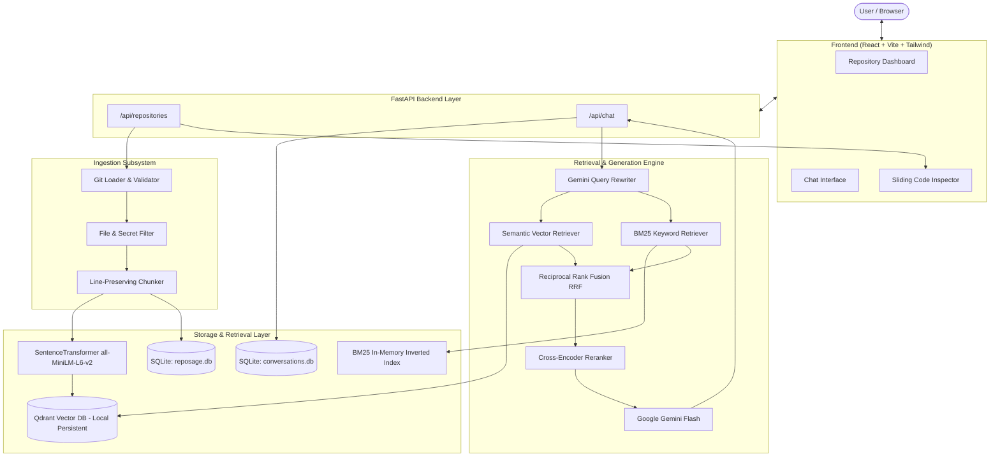
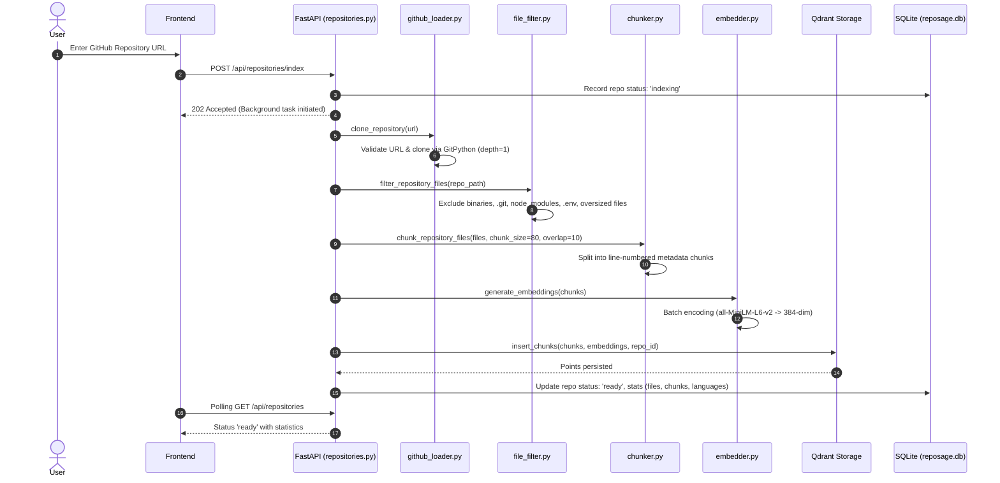
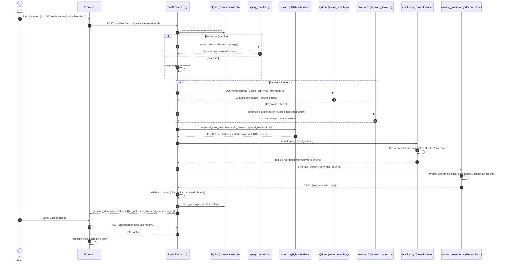

# RepoSage: End-to-End Technical Documentation & Comprehensive Interview Guide

This document covers the architectural, implementation, mathematical, algorithmic, and interview aspects of **RepoSage** — an AI-powered codebase intelligence system powered by Advanced Retrieval-Augmented Generation (RAG).

---

## Table of Contents
1. [Executive Summary & Motivation](#1-executive-summary--motivation)
2. [High-Level Design (HLD)](#2-high-level-design-hld)
   - Core Architecture Diagram
   - Pipeline 1: Repository Ingestion & Indexing Pipeline
   - Pipeline 2: Question-Answering & Retrieval Pipeline
3. [Low-Level Design (LLD)](#3-low-level-design-lld)
   - Ingestion Subsystem (`github_loader`, `file_filter`, `chunker`)
   - Embedding & Storage Subsystem (`embedder`, `vector_search`)
   - Advanced Retrieval Subsystem (`keyword_search`, `semantic_search`, `fusion`, `reranker`)
   - Generation & Conversation Subsystem (`answer_generator`, `query_rewriter`, `memory`)
   - Database Schemas (SQLite Metadata & Conversations)
   - REST API Specifications
4. [Algorithmic & Mathematical Formulations](#4-algorithmic--mathematical-formulations)
   - BM25Okapi Formulation
   - Vector Similarity (Cosine Metric)
   - Reciprocal Rank Fusion (RRF)
   - Cross-Encoder Scoring vs. Bi-Encoder Embedding
5. [Technical Stack & Configuration Reference](#5-technical-stack--configuration-reference)
6. [Design Tradeoffs & Engineering Decisions](#6-design-tradeoffs--engineering-decisions)
7. [Comprehensive Interview Q&A Bank](#7-comprehensive-interview-qa-bank)

---

## 1. Executive Summary & Motivation

### The Problem
Navigating unfamiliar, large-scale source code repositories presents significant cognitive overhead for developers. Traditional keyword search (such as `grep` or IDE text search) fails to capture semantic meaning (e.g., searching for "where do users log in?" fails if the codebase uses `authenticate()` or `verify_token()`). Conversely, standard naive LLMs hallucinate non-existent files or functions, lack awareness of private internal repositories, and cannot provide verifiable line citations.

### The Solution: RepoSage
RepoSage implements an **Advanced RAG (Retrieval-Augmented Generation)** architecture tailored specifically for source code. It features:
- **Repository Ingestion**: Automated cloning, safety validation, directory filtering, and language-aware chunking.
- **Hybrid Retrieval**: Combines semantic retrieval (`sentence-transformers/all-MiniLM-L6-v2` in local Qdrant) with identifier-aware exact keyword retrieval (`rank-bm25`).
- **Reciprocal Rank Fusion (RRF)**: Merges rank positions from heterogeneous retrieval systems without scale distortion.
- **Cross-Encoder Reranking**: Uses `cross-encoder/ms-marco-MiniLM-L-6-v2` to evaluate query-chunk relevance.
- **Constrained LLM Generation**: Grounded generation via Google Gemini Flash with strict rules preventing hallucination and enforcing source-backed line citations.
- **Interactive UI**: A modern dashboard with conversation memory, multi-turn query rewriting, and an in-browser code viewer that scrolls to and highlights cited line numbers.

---

## 2. High-Level Design (HLD)

### 2.1 System Architecture Diagram



---

### 2.2 Pipeline 1: Repository Indexing Pipeline



---

### 2.3 Pipeline 2: Question-Answering & Retrieval Pipeline



---

## 3. Low-Level Design (LLD)

### 3.1 Module Breakdown

#### `backend/config.py`
Centralizes system-wide configuration, environment variables, model identifiers, and default hyper-parameters:
- `DEFAULT_CHUNK_SIZE = 80` (lines)
- `DEFAULT_CHUNK_OVERLAP = 10` (lines)
- `EMBEDDING_MODEL_NAME = "all-MiniLM-L6-v2"`
- `EMBEDDING_DIMENSION = 384`
- `CROSS_ENCODER_MODEL_NAME = "cross-encoder/ms-marco-MiniLM-L-6-v2"`
- `GEMINI_MODEL_NAME = "gemini-2.5-flash"`
- `RRF_K = 60`

#### `backend/ingestion/github_loader.py`
- **Validation**: Enforces strict HTTPS GitHub URLs via `urllib.parse.urlparse` and regex syntax checking.
- **Execution**: Uses `git.Repo.clone_from` with `--depth 1` (shallow clone) to minimize bandwidth, disk space, and cloning latency.
- **Isolation**: Each repository is placed into its own folder `data/repositories/{repo_name}_{repo_id}` to prevent cross-repository file collisions.
- **Safety**: Cloned code is strictly parsed as passive text files and never executed.

#### `backend/ingestion/file_filter.py`
Traverses repository file trees and filters out irrelevant content:
- **Whitelisted Source Extensions**: `.py`, `.js`, `.jsx`, `.ts`, `.tsx`, `.java`, `.cpp`, `.c`, `.h`, `.hpp`, `.go`, `.rs`, `.html`, `.css`, `.json`, `.md`, `.yaml`, `.yml`, `.sql`.
- **Ignored Directories**: `.git`, `node_modules`, `venv`, `.venv`, `dist`, `build`, `__pycache__`, `coverage`.
- **Secret & Sensitive Exclusions**: `.env`, `.env.*`, `*.pem`, `*.key`, `*.cert`.
- **Size Safeguards**: Skips individual files greater than 500 KB to avoid memory bloat and degenerate tokenization.

#### `backend/ingestion/chunker.py`
- Operates on a line-based sliding window:
  - `start_line = i + 1`
  - `end_line = min(i + chunk_size, total_lines)`
  - `overlap = 10` lines (maintains context across chunk transitions).
- Generates a deterministic or UUID-based `chunk_id` for each slice:
```json
{
  "chunk_id": "c03c3d01-50cb-4450-88bc-6d6c99132c6c",
  "file_path": "test/Router.js",
  "start_line": 71,
  "end_line": 150,
  "language": "javascript",
  "content": "..."
}
```

#### `backend/embeddings/embedder.py`
- Encapsulates `SentenceTransformer("all-MiniLM-L6-v2")`.
- Produces normalized 384-dimensional dense vectors.
- Employs batch encoding (`batch_size=32`) with `normalize_embeddings=True` so that dot products directly compute cosine similarity.

#### `backend/retrieval/vector_search.py`
- Integrates with local persistent Qdrant (`QdrantClient(path="data/qdrant_storage")`).
- Uses `models.Distance.COSINE`.
- Metadata Payload:
  - `repository_id`
  - `chunk_id`
  - `file_path`
  - `start_line`
  - `end_line`
  - `language`
  - `content`
- Implements strict metadata filtering on queries via `models.FieldCondition(key="repository_id", match=models.MatchValue(value=repository_id))` to guarantee zero cross-repository data leakage.
- Includes `get_repository_chunks(repository_id)` to extract payload data for dynamic in-memory BM25 index generation.

#### `backend/retrieval/keyword_search.py`
- Implements `rank-bm25` (BM25Okapi).
- **Identifier-Aware Tokenization**:
  - Splits camelCase identifiers (e.g. `verifyToken` -> `verify Token`).
  - Regex tokenization: `[a-zA-Z_][a-zA-Z0-9_]*|\d+` to preserve programming keywords, variable names, and numerical parameters.
  - Case folding (`.lower()`).

#### `backend/retrieval/fusion.py`
- Merges ranked lists from `SemanticRetriever` and `KeywordSearch` via Reciprocal Rank Fusion (RRF).
- Deduplicates chunks using `(repository_id, chunk_id)` as the unique primary key.

#### `backend/retrieval/reranker.py`
- Uses `CrossEncoder("cross-encoder/ms-marco-MiniLM-L-6-v2")`.
- Takes query-chunk pairs `[query, chunk_content]` and performs cross-attention over all tokens simultaneously.
- Scores and reorders the top candidates, yielding the final 5–6 chunks passed to the LLM.

#### `backend/generation/answer_generator.py`
- Connects to Google Gemini API (`gemini-2.5-flash`).
- Formulates a system prompt requiring structured JSON output (`response_mime_type="application/json"`).
- Strict hallucination boundaries:
  - Answers must rely strictly on provided context.
  - If information is missing, it must explicitly state: *"The answer cannot be determined from the retrieved code."*
  - Requires citation IDs matching provided `SOURCE_ID` tags.
- Post-validation: Filters returned citation IDs against the actual list of retrieved chunks to prevent fabricated citations.

#### `backend/generation/query_rewriter.py`
- Uses Gemini Flash to rewrite follow-up questions (e.g., *"Where is it invoked?"*) into standalone search queries based on the preceding conversation turns.

#### `backend/conversation/memory.py`
- Persistent multi-turn conversation storage backed by SQLite (`conversations.db`).
- Tracks `sessions` and `messages`.
- Automatically associates each session with its target `repository_id`.

---

### 3.2 Database Schema Designs

#### Database 1: Repository Metadata (`data/reposage.db`)

```sql
CREATE TABLE repositories (
    repository_id TEXT PRIMARY KEY,
    repository_name TEXT NOT NULL,
    repository_url TEXT NOT NULL,
    local_path TEXT NOT NULL,
    status TEXT NOT NULL, -- 'cloning', 'indexing', 'ready', 'failed'
    total_files INTEGER DEFAULT 0,
    total_chunks INTEGER DEFAULT 0,
    languages TEXT DEFAULT '[]', -- JSON array of detected languages
    error_message TEXT,
    created_at TEXT NOT NULL,
    indexed_at TEXT
);

CREATE TABLE repository_files (
    id INTEGER PRIMARY KEY AUTOINCREMENT,
    repository_id TEXT NOT NULL,
    file_path TEXT NOT NULL,
    language TEXT,
    chunk_count INTEGER DEFAULT 0,
    FOREIGN KEY (repository_id) REFERENCES repositories(repository_id)
);

CREATE INDEX idx_repo_files_repo_id ON repository_files(repository_id);
```

#### Database 2: Conversational Memory (`data/conversations.db`)

```sql
CREATE TABLE sessions (
    session_id TEXT PRIMARY KEY,
    repository_id TEXT NOT NULL,
    created_at TEXT NOT NULL
);

CREATE TABLE messages (
    id INTEGER PRIMARY KEY AUTOINCREMENT,
    session_id TEXT NOT NULL,
    repository_id TEXT NOT NULL,
    role TEXT NOT NULL, -- 'user' | 'assistant'
    content TEXT NOT NULL,
    created_at TEXT NOT NULL,
    FOREIGN KEY(session_id) REFERENCES sessions(session_id)
);

CREATE INDEX idx_messages_session_repository ON messages(session_id, repository_id, id);
```

---

## 4. Algorithmic & Mathematical Formulations

### 4.1 BM25Okapi Formulation
For a tokenized user query $Q = \{q_1, q_2, \dots, q_n\}$ and a source chunk $D$, the BM25 score is computed as:

$$\text{Score}(D, Q) = \sum_{i=1}^n \text{IDF}(q_i) \cdot \frac{f(q_i, D) \cdot (k_1 + 1)}{f(q_i, D) + k_1 \cdot \left(1 - b + b \cdot \frac{|D|}{\text{avgdl}}\right)}$$

Where:
- $f(q_i, D)$: Raw frequency of token $q_i$ in chunk $D$.
- $|D|$: Length of chunk $D$ in tokens.
- $\text{avgdl}$: Average chunk length across the entire indexed repository.
- $k_1$: Term frequency saturation parameter (default: $1.5$).
- $b$: Document length normalization parameter (default: $0.75$).
- $\text{IDF}(q_i)$: Inverse Document Frequency, defined as:

$$\text{IDF}(q_i) = \ln \left(\frac{N - n(q_i) + 0.5}{n(q_i) + 0.5} + 1\right)$$

Where $N$ is total chunks in repository and $n(q_i)$ is number of chunks containing $q_i$.

---

### 4.2 Dense Vector Similarity (Cosine Metric)
Given the embedding of query $u \in \mathbb{R}^{384}$ and code chunk $v \in \mathbb{R}^{384}$:

$$\text{Sim}(u, v) = \frac{u \cdot v}{\|u\|_2 \|v\|_2} = \frac{\sum_{i=1}^{384} u_i v_i}{\sqrt{\sum_{i=1}^{384} u_i^2} \sqrt{\sum_{i=1}^{384} v_i^2}}$$

Because both query and chunk vectors are normalized to unit length ($\|u\|_2 = 1, \|v\|_2 = 1$) during embedding generation, the cosine similarity reduces directly to the dot product:

$$\text{Sim}(u, v) = u \cdot v = \sum_{i=1}^{384} u_i v_i$$

---

### 4.3 Reciprocal Rank Fusion (RRF)
BM25 scores and cosine similarity scores have entirely different mathematical distributions: cosine values reside in $[-1, 1]$ (or $[0, 1]$), while BM25 scores are unbounded $[0, \infty)$ dependent on term frequencies. Simply summing raw scores leads to one system dominating the other.

RRF solves this by combining the **rank positions** of items rather than their raw scores:

$$\text{RRF\_Score}(d \in D) = \sum_{m \in M} \frac{1}{k + r_m(d)}$$

Where:
- $M$: The set of retrieval systems ($M = \{\text{Semantic Retriever}, \text{BM25 Retriever}\}$).
- $r_m(d)$: The 1-based rank position of chunk $d$ in system $m$'s returned list (e.g. 1st = 1, 2nd = 2). If an item does not appear in a system's top-$K$, its term is $0$.
- $k$: Smoothing constant (default: $60$). It dampens the disproportionate advantage of high ranks.

---

### 4.4 Bi-Encoder vs. Cross-Encoder Architecture

| Feature | Bi-Encoder (`all-MiniLM-L6-v2`) | Cross-Encoder (`ms-marco-MiniLM-L-6-v2`) |
| :--- | :--- | :--- |
| **Input Structure** | $E(Q)$ and $E(D)$ are encoded independently. | $(Q, D)$ pair is passed together into the transformer. |
| **Attention Mechanism** | Intra-attention within $Q$, intra-attention within $D$. No cross-attention. | Full cross-attention between every token in $Q$ and every token in $D$. |
| **Computational Cost** | $O(|Q|) + O(|D|)$ once; vector search is $O(1)$ with ANN. Fast. | $O((|Q| + |D|)^2)$. Computationally heavy. |
| **Accuracy / Relevance** | High for broad semantic search, but misses fine token interactions. | Extremely high relevance ranking and token-level relationship scoring. |
| **Role in RepoSage** | Initial candidate retrieval from $N$ chunks down to top-10. | Reranking top-10 candidates down to top-5 most relevant chunks. |

---

## 5. Technical Stack & Configuration Reference

| Component | Technology | Version | Justification |
| :--- | :--- | :--- | :--- |
| **Backend Framework** | FastAPI | 0.115+ | High-throughput asynchronous endpoints, automatic Pydantic validation, and native background task support. |
| **ASGI Server** | Uvicorn | 0.34+ | Lightweight and robust ASGI server for Python web applications. |
| **Git Ingestion** | GitPython | 3.1+ | Programmatic shallow cloning and commit inspection. |
| **Vector Database** | Qdrant Client | 1.13+ | Fast vector engine with local embedded persistence (zero Docker or cloud setup needed) and strong payload filtering. |
| **Dense Embeddings** | SentenceTransformers (`all-MiniLM-L6-v2`) | 3.4+ | 384-dimensional dense vectors with strong retrieval quality and fast CPU inference. |
| **Sparse Retrieval** | rank-bm25 | 0.2.2 | In-memory Okapi BM25 implementation for identifier and keyword matching. |
| **Reranker** | CrossEncoder (`ms-marco-MiniLM-L-6-v2`) | 3.4+ | High precision reranking based on query-document cross-attention. |
| **Foundation LLM** | Google Gemini Flash | 2.5 | High-speed generative inference with native JSON schema constraints and long context handling. |
| **Metadata Database** | SQLite3 | Native | Zero-dependency, file-based relational store for repositories and conversation history. |
| **Frontend Framework** | React | 19.x | Declarative UI state management. |
| **Build Tooling** | Vite | 6.x / 8.x | Near-instant HMR and fast Rollup-based production builds. |
| **Styling** | Tailwind CSS | v4 | Modern utility-first styling with minimal CSS overhead. |
| **Icons** | Lucide React | 1.x | Clean developer and code-focused iconography. |

---

## 6. Design Tradeoffs & Engineering Decisions

1. **Why Hybrid Search (BM25 + Semantic) instead of Semantic Search alone?**
   - *Problem*: In codebases, developers frequently search for exact identifiers, such as `verifyToken`, `JWT_SECRET`, or `onRouteChanged`. Dense embedding models sometimes generalize these away as generic "authentication" concepts, yielding irrelevant results when an exact variable match exists.
   - *Tradeoff*: BM25 handles exact keyword token matches with zero training, while dense vector search captures semantic concepts (e.g. "where are passwords hashed?"). Combining them via RRF delivers the strengths of both approaches.

2. **Why Local Qdrant Storage instead of a Managed Cloud Vector DB (Pinecone/Weaviate Cloud)?**
   - *Decision*: RepoSage targets quick local setup and isolated development environments. Local persistent Qdrant operates directly on the local file system with zero network latency, no subscription keys, and fully offline vector query support.

3. **Why Sliding Line Chunking with Overlap instead of AST/Tree-sitter Parsing for the MVP?**
   - *Decision*: AST-based chunking requires language-specific grammar parsers for every language in a repository. Line-based sliding chunking (80 lines, 10-line overlap) works universally across all 18+ supported languages while preserving original line numbers.

4. **Why enforce JSON Mode for Gemini LLM Generation?**
   - *Problem*: LLMs often produce conversational markdown text with citations embedded in varying styles, making parsing fragile.
   - *Decision*: Setting `response_mime_type="application/json"` forces Gemini to separate the response into an `answer` string and an array of `citation_ids`. The backend validates that every cited ID was actually retrieved before passing it to the frontend.

---

## 7. Comprehensive Interview Q&A Bank

### Q1: Can you explain the end-to-end architecture of RepoSage?
> **Answer**: RepoSage is an Advanced RAG codebase intelligence tool. It has two main pipelines:
> 1. **Ingestion Pipeline**: The user inputs a GitHub URL. The backend validates and shallow-clones it, filters out non-source files (binaries, node_modules, secrets), chunks the source code using an 80-line sliding window with a 10-line overlap, embeds the chunks via `all-MiniLM-L6-v2` into 384-dimensional vectors, and persists them into a local Qdrant collection alongside payload metadata.
> 2. **Querying Pipeline**: When a question is submitted, the conversation history is pulled from SQLite, and follow-up questions are resolved via a Gemini query rewriter. The query is dispatched simultaneously to Qdrant (dense semantic search) and an in-memory BM25 index (sparse search). Results are merged using Reciprocal Rank Fusion (RRF, $k=60$) and reranked using a Cross-Encoder (`ms-marco-MiniLM-L-6-v2`). The top chunks are formatted into a system-constrained Gemini Flash prompt that returns structured JSON with verifiable line-level citations. The user can click any citation in the frontend to inspect and highlight the code.

### Q2: What is the difference between Naive RAG and Advanced RAG, and where does RepoSage fit?
> **Answer**: Naive RAG consists of simple chunking, single-index vector search (bi-encoder top-$K$), and immediate context injection into an LLM. This often fails on codebases due to low precision on exact identifiers, semantic drift, and chunk boundary truncation.
> RepoSage implements **Advanced RAG**:
> - **Pre-retrieval**: Multi-turn query rewriting.
> - **Hybrid Retrieval**: Combining dense semantic search with sparse BM25 keyword matching.
> - **Post-retrieval**: Reciprocal Rank Fusion followed by Cross-Encoder reranking.
> - **Verification & Validation**: LLM citations are cross-referenced with retrieved chunk metadata before being sent to the client.

### Q3: Why is Reciprocal Rank Fusion (RRF) preferred over linear score combination?
> **Answer**: Dense semantic similarity produces scores bounded by $[-1, 1]$ (or $[0, 1]$), while BM25 produces unbounded scores $[0, \infty)$ dependent on term counts and document length. Linear combination ($\alpha \cdot S_{\text{vector}} + \beta \cdot S_{\text{bm25}}$) requires extensive heuristic parameter tuning and is brittle across varying query types. RRF relies strictly on relative rank positions:
> $$\text{RRF\_Score}(d) = \sum_{m} \frac{1}{k + \text{rank}_m(d)}$$
> This normalizes disparate scoring systems, rewards documents retrieved by both methods, and provides stable, hyper-parameter-resilient ranking.

### Q4: How does RepoSage prevent cross-repository data contamination?
> **Answer**: RepoSage enforces multi-tenancy isolation at both the vector database and filesystem layers:
> 1. Each repository receives a distinct `repository_id` (UUID).
> 2. Every point stored in Qdrant has `repository_id` in its payload.
> 3. All vector queries enforce a strict filter:
>    ```python
>    query_filter=models.Filter(
>        must=[models.FieldCondition(key="repository_id", match=models.MatchValue(value=repository_id))]
>    )
>    ```
> 4. In SQLite, messages and sessions are scoped to their corresponding `repository_id`.
> 5. Filesystem inspection endpoints validate that requested file paths stay confined within the repository's dedicated directory.

### Q5: How do you handle LLM hallucinations and invalid citations?
> **Answer**: Three layers of guardrails are enforced:
> 1. **Prompt Constraint**: The system prompt instructs Gemini to use only provided context and explicitly reply *"The answer cannot be determined from the retrieved code."* if the context is insufficient.
> 2. **Structured JSON Mode**: The LLM outputs citation IDs referencing explicit `SOURCE_ID` metadata tags provided in the prompt context.
> 3. **Backend Citation Validation**: The backend filters the returned `citation_ids` against the set of chunks actually retrieved for that query. Any hallucinated citation ID is discarded before the response reaches the frontend.

### Q6: What are the performance bottlenecks in this architecture and how would you scale it?
> **Answer**:
> - **Ingestion Bottleneck**: Embedding large repositories sequentially can be slow on CPU. *Mitigation*: Batch embeddings across worker processes, utilize GPU acceleration (`cuda`), or run indexing workers via asynchronous Celery/Redis queues.
> - **Reranking Latency**: Cross-encoders have quadratic attention complexity $O((|Q| + |D|)^2)$. *Mitigation*: Limit reranker candidate pool (e.g., top-10 only) and return the top 5 chunks.
> - **Concurrency & Scale**: To scale to thousands of repositories, transition from embedded SQLite/Qdrant to a dedicated client-server deployment (e.g., Qdrant Distributed Cluster, PostgreSQL for metadata, and shared S3/GCS object storage for cloned repositories).
